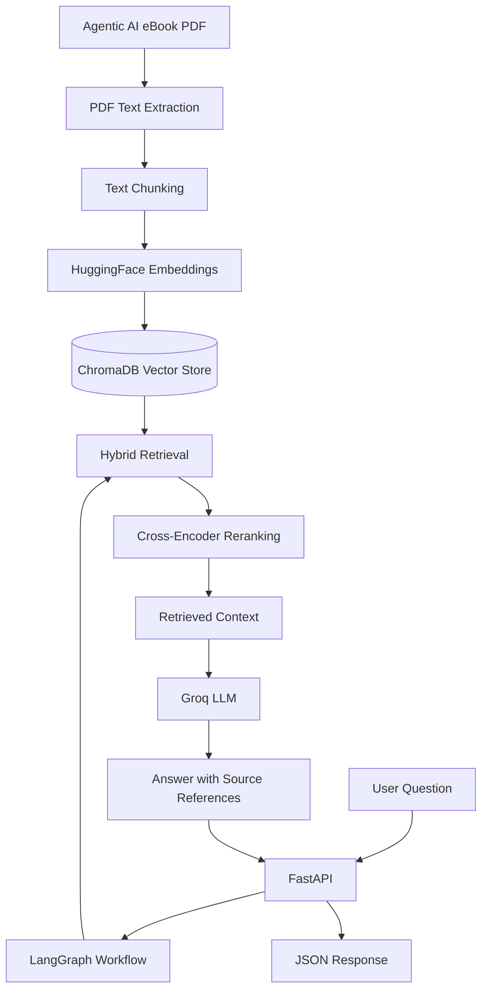

# Agentic AI eBook Chatbot

A Retrieval-Augmented Generation (RAG) chatbot that answers questions using information extracted from the *Agentic AI for Executives* eBook.

The application combines hybrid document retrieval, cross-encoder reranking, LangGraph orchestration, and Groq-powered language generation to provide context-grounded answers with source page references.

## Features

- PDF ingestion and text extraction using PyMuPDF.
- Text chunking with overlapping segments.
- Semantic search using HuggingFace sentence embeddings and ChromaDB.
- Hybrid retrieval combining vector search and BM25 keyword search.
- Cross-encoder reranking of retrieved chunks.
- LangGraph workflow for retrieval and answer generation.
- Groq LLM integration for natural-language responses.
- FastAPI REST API with interactive Swagger documentation.
- Source page references and retrieval relevance scores.
- Input validation and error handling.

## Architecture



## Technology Stack

| Component | Technology |
|---|---|
| Language | Python |
| PDF processing | PyMuPDF |
| Embeddings | HuggingFace Sentence Transformers |
| Vector database | ChromaDB |
| Keyword retrieval | BM25 |
| Reranking | Cross-Encoder |
| Workflow orchestration | LangGraph |
| LLM | Groq API |
| Backend | FastAPI |
| Testing | Pytest |

## Project Structure

```text
Agentic AI Chatbot/
├── app/
│   ├── __init__.py
│   ├── config.py
│   ├── ingest.py
│   ├── retriever.py
│   ├── graph.py
│   ├── schemas.py
│   └── main.py
├── data/
│   └── Ebook-Agentic-AI.pdf
├── tests/
│   └── test_rag.py
├── chroma_db/
├── .env.example
├── .gitignore
├── requirements.txt
└── README.md
```

The PDF and generated vector database are local project assets and should not be committed unless distribution is permitted.

## Setup and Installation

### 1. Clone the repository

```bash
git clone YOUR_GITHUB_REPOSITORY_URL
cd YOUR_REPOSITORY_FOLDER
```

### 2. Create a virtual environment

```bash
python -m venv .venv
```

Activate it on Windows:

```powershell
.venv\Scripts\Activate.ps1
```

### 3. Install dependencies

```bash
pip install -r requirements.txt
```

### 4. Configure environment variables

Create a `.env` file in the project root:

```env
GROQ_API_KEY=your_groq_api_key
GROQ_MODEL=openai/gpt-oss-20b
```

Obtain your API key from the Groq Console.

Never commit your actual API key.

### 5. Add the eBook

Place the authorized Agentic AI eBook PDF in the `data/` directory, using the filename expected by the ingestion script.

### 6. Ingest the PDF

```bash
python -m app.ingest
```

This extracts the PDF text, splits it into chunks, generates embeddings, and stores them in ChromaDB.

Run ingestion before starting the application if the vector database has not been created.

## Running the Application

Start the FastAPI server:

```bash
uvicorn app.main:app --reload
```

Open the interactive API documentation:

http://127.0.0.1:8000/docs

Health check:

```http
GET /health
```

## Example API Request

Endpoint:

```http
POST /ask
Content-Type: application/json
```

Request body:

```json
{
  "question": "What are the key components of an Agentic AI system?"
}
```

The API returns a JSON response containing the question, generated answer, retrieved source passages, page references, and retrieval relevance information.

Example response structure:

```json
{
  "question": "What are the key components of an Agentic AI system?",
  "answer": "The eBook identifies perception, reasoning, planning, learning, and execution as the five core components.",
  "sources": [
    {
      "page": 19,
      "content": "Retrieved source passage...",
      "relevance_score": 5.68
    }
  ],
  "confidence": 5.68,
  "confidence_note": "The confidence field contains the highest retrieval relevance score, not a probability of answer correctness."
}
```

The example answer and scores are illustrative. Actual responses depend on the retrieved context and model output.

## Sample Questions

1. What is Agentic AI?
2. What are the key components of an Agentic AI system?
3. What is the role of learning in Agentic AI?
4. How does an agent interact with its environment?
5. What are the different types of agents discussed in the eBook?

## Evaluation and Testing

Run the automated tests:

```bash
python -m pytest tests/ -v
```

The current test suite covers:

- Health endpoint response.
- Question-answer API integration.
- Validation of empty questions.

Latest local test result: **3 tests passed.**

The answer-generation integration test requires a valid Groq API key and network access.

## Limitations

- Responses depend on the quality and completeness of the retrieved eBook passages.
- The chatbot is restricted to the provided eBook context.
- Retrieval relevance scores are not calibrated probabilities of factual correctness.
- Groq API availability, rate limits, and model access affect answer generation.
- Scanned or poorly formatted PDF pages may require additional OCR preprocessing.

## Future Improvements

- Add retrieval evaluation using precision, recall, and ranking metrics.
- Implement automated answer-grounding and citation validation.
- Improve handling of tables, diagrams, and scanned PDF pages.
- Add a conversational user interface.
- Introduce caching and monitoring for production deployment.

## License

This project was developed as an educational and technical assignment. Ensure that the eBook and any third-party assets are distributed only when their licenses permit it.
